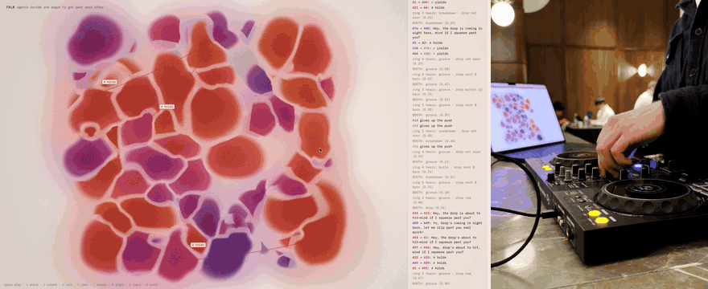

# Agent Crowd

**100 Gemini agents dance to a live DJ set and argue their way to the front of the room.**




*Left: the crowd during a drop, with agents asking each other to squeeze past (chat on the right). Right: the
same visuals running next to the decks at the hackathon.*

## What it is

A crowd of 100 AI agents sits in a 3D "aquarium" in front of the DJ. They only **hear** the music, with no
track names and no reading ahead, and each one decides what to do next: push forward, dance, rest or step
aside. Everyone wants the hot spot at the front when the drop hits.

- **Every agent listens.** Every ~3 s each ring of the crowd gets its own 8 s audio clip: loud and bassy at
  the front, muffled at the back. Each agent picks an action from what it hears and its personality.
- **Agents talk.** A blocked agent asks the one in its way to let it past, in its own words, and the other
  agent decides whether to move. Nobody is told to be honest; claims are checked against their real traits.
- **The screen is for the DJ.** Each agent is a soft blob of pigment. Color is happiness, density is
  energy, and the bodies squash and flatten against each other as the crowd packs in on a drop.

Models: Gemini 4 Decisions (listening and choosing), Gemini 4 Hydrogen (the asks), Gemini 4 Neon (the
post-run report).

## Run it

```
uv venv --python 3.11 .venv && uv pip install -p .venv/bin/python -r requirements.txt
.venv/bin/python -m server.main --seed 1 --condition talk   # backend, port 8001
cd web && npm install && npm run dev                        # http://localhost:5174
```

Put `GEMINI_API_KEY`, `MODEL_DECISIONS`, `MODEL_HYDROGEN` and `MODEL_NEON` in `.env` and MP3s in `tracks/`.
Open the page, press `I` to pick a track or a live input (e.g. Rekordbox via BlackHole), and play.
`1` / `2` / `3` switch between a scripted crowd, agents that decide silently, and agents that talk.

## What we found

- **The back of the room hears the drop late.** Agents at the front predicted when the drop would land 83%
  of the time; at the back, 53%. The only difference between them was the filtered audio.
- **Agents ask politely and honestly.** 337 asks, about one in four accepted, almost no overclaiming.
- **Thinking agents pace themselves** (most rest during breakdowns), but they didn't end up happier than a
  scripted crowd.

These come from one early run per mode, so treat them as anecdotes. The full engineering log, design
decisions and what broke are in [docs/notes.md](docs/notes.md).

## Credits

Built in a day at the Gemini 4 Hackathon in New York City.
Rendering by [three.js](https://threejs.org) (MIT).
