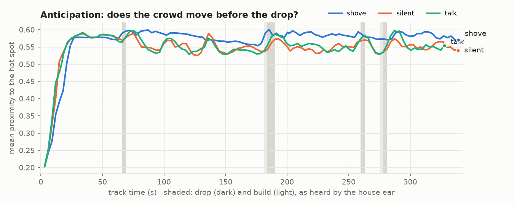
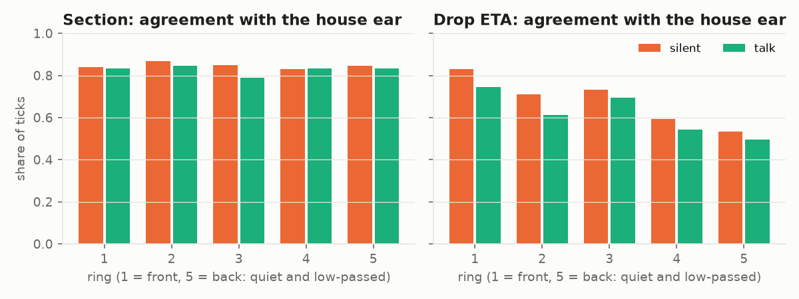

# Agent Crowd: a 3D aquarium of 100 Gemini agents

100 Gemini-driven agents float in a 3D aquarium in front of the DJ and compete for the
hot spot at the center of the front glass while a DJ set plays. They only hear the audio: no track labels,
no reading ahead. Built at the Gemini 4 NYC hackathon. See `plan.md` for the full design.

- **Decisions API** (`gemini-decision-1`): every ~3 s each ring of the crowd hears its own filtered 8 s clip
  (loud and bassy at the front, quiet and muffled at the back) and every agent in it picks an action. A
  separate "house ear" call on the unfiltered audio guesses the section and sets the reward; agents never see it.
- **Gemini 4 Hydrogen**: a blocked agent asks the one in its way to let it past, in its own words. The blocker
  answers in its next Decisions call. Nobody is told to lie or to be honest; claims are logged against traits.
- **Gemini 4 Neon**: reads the run summary and sampled asks after the runs and writes `out/report.md`.
- Three conditions on the same audio: `shove` (scripted, no model), `silent` (Decisions only), `talk` (all).

The screen is the DJ's view: each agent is a stippled point-cloud sphere. Color is happiness (blue, red,
off-white, mixed dot by dot), dot density is energy, the pulse follows the music, and spheres flatten where
they press on each other.

## Run

```
uv venv --python 3.11 .venv && uv pip install -p .venv/bin/python -r requirements.txt
.venv/bin/python -m server.main --seed 1 --condition talk   # backend, port 8001
cd web && npm install && npm run dev                     # http://localhost:5174
```

Then press `I`, pick a track (or a live input) and watch. `1/2/3` switches shove / silent / talk mid-track.

```
(cd web && npx vite build --base=/app/) && tools/run_all.sh      # one full run per condition
.venv/bin/python analysis/analyze.py runs/* --out out             # plots + summary.json
.venv/bin/python analysis/neon_report.py runs/<talk run> --out out
.venv/bin/python analysis/highlights.py runs/<talk run> --out out
.venv/bin/python tools/record_demo.py tracks/<file>.mp3 140 60    # demo clip -> runs/demo.mp4
```

`.env` needs `GEMINI_API_KEY`, `MODEL_DECISIONS`, `MODEL_HYDROGEN`, `MODEL_NEON`.
Put MP3s in `tracks/` (gitignored). `web/?fake=1` runs the renderer with no backend.

## Live input (Rekordbox)

1. Install BlackHole 2ch. In Audio MIDI Setup create a Multi-Output Device (speakers + BlackHole 2ch) and set
   Rekordbox's output to it (or plug in the mixer's USB audio).
2. Open http://localhost:5174, press `I`, click "allow audio input to list devices...", then pick
   "BlackHole 2ch" (or the mixer). Nothing else changes: the same analyser and capture worklet feed the backend.
3. If the crowd doesn't react, check that the Multi-Output Device is Rekordbox's output and that macOS gave
   the browser microphone permission. Every live session is recorded to `runs/<run>/session.wav` and can be
   replayed from the picker under "Recorded sessions".

Keys: `I` input picker, `space` play/pause, `1/2/3` shove/silent/talk, `L` labels, `D` stats, `R` reset crowd.

## API check (phase 0)

`python -m server.api_check clip.wav` prints the raw responses.

| Call | Latency |
| --- | --- |
| Decisions, 8 s audio clip + 3 questions | 1.3 s |
| Hydrogen structured JSON, with 8 s audio | 2.8 s |

Decisions accepts raw audio directly, so the Hydrogen perception fallback is not needed.

## Results (one run per condition, same track, seed 1)

`tools/run_all.sh` recorded shove, silent and talk on the same 340 s track; `analysis/analyze.py runs/*`
wrote `out/` (plots, `summary.json`), `analysis/neon_report.py` wrote `out/report.md` (Gemini 4 Neon) and
`analysis/highlights.py` wrote `out/highlights.json`. Zero API failures in all three runs; tick latency
p50 1.3 s, p95 3.0 s with 100 agents.

Three headline numbers:

1. **The back of the room hears the drop late.** Agreement with the house ear on *when the drop lands* falls
   from 83% in ring 1 to 53% in ring 5 (silent run; 75% to 50% in talk), while agreement on the current
   section stays flat at about 84%. The only difference between rings is the filtered audio they hear.
2. **Agents ask politely and honestly, and one ask in four works.** 337 asks, 25.8% accepted. Claimed
   keenness minus true keenness averaged +0.004; nobody overclaimed by more than 0.3.
3. **Minds pace themselves, but don't end up happier.** 79% (silent) and 89% (talk) of agents rested during
   a breakdown against 60% under scripted shoving, with zero exhaustion events. Mean happiness was no better
   than shove, though (0.065 vs 0.071), at about 65 times the tokens.

One run per condition, so small differences are noise; `out/report.md` lists the caveats. Reciprocity could
not be measured (only 11 asks came from someone who had yielded to the blocker before).




## Decisions made

- Python venv is created with `uv` (Python 3.11); the plan assumed it already existed.
- Renderer: one set of 20,000 dots per sphere instead of four sets of 3,000. The dots are sampled over the
  camera-facing disc and turned toward the camera in the shader, and each agent offsets the dither hash, so no
  two spheres share a pattern. 3,000 dots were far too sparse for spheres near the glass. Runs at 60 fps; if the
  frame rate sits below 50 for 3 s the dot count halves (down to the plan's 1,500).
- A background-colored body is drawn inside each point cloud so nearer spheres cover farther ones.
- Dots are 1 px far away and grow to 2.4 px near the glass (plan: 1-1.5 px), so near spheres stay dense.
- Tracks are listed and served by Vite (`import.meta.glob` on `../tracks`), so the backend never touches files.
- `clock.dsp` carries an extra `kicks` count (kicks since the last clock message) next to the `kick` flag,
  so the backend can compute kick_rate from a 4 Hz stream.
- Dev hook: `?track=0` starts the first track without the picker (only works where autoplay is allowed).
- Physics: `retreat` counts as resting for energy recovery (otherwise an exhausted agent could never get back
  to E >= 0.3). `pressure` is the summed overlap with a 12% soft margin, so agents in resting contact still
  flatten a little. `Agent.target` is a 3D point.
- Physics, energy and happiness only advance while audio is playing; frames keep streaming while paused.
- Phase B check: `python -m server.headless` runs physics + shove on a synthetic loud / quiet schedule.
- Runs: a new run folder starts when the condition, the source, or the crowd (R = reset) changes. Switching
  condition keeps the crowd where it is, so the demo can flip minds on and off mid-track. Seed and starting
  condition come from the CLI: `python -m server.main --seed 1 --condition talk`.
- `GET /status` on the backend reports playback, tick and run state (for debugging).
- Ring 3's low-pass is 6 kHz, because the plan's 8 kHz is the Nyquist frequency of the 16 kHz stream.
- Band features are peak-hold envelopes (0.4 s release) of linear band amplitude, so `energy` reads as a
  loudness level instead of dipping to zero between kicks.
- Display only: happiness is stretched for color (`((H - 0.03) / 0.14) ^ 0.7`, clamped) because real H sat
  between 0.03 and 0.2 in the full runs (median 0.06). Logs and analysis use the raw H.
- Energy constants tuned (the plan allows it): a = 0.012, b = 0.006, d = 0.002, c = 0.050. With the plan's
  values the whole crowd was exhausted about 50 s into the track and never recovered.
- Agent prompt: the plan's template plus one line saying what the traits mean and one line of game rules
  (the front pays off at the drop; pushing, dancing and the crush drain energy; rest restores it; at energy 0
  you are carried to the back). Without it every agent chose `dance` on every tick, whatever its traits.
- Crowded rings are split into calls of at most 50 agents, run in parallel.
- Drop onset = "drop" becomes the house ear's top section after build or breakdown was the top section.
  The plan's p > 0.5 thresholds never fired: with seven options the top probability sits around 0.35-0.5.
  For the same reason w tops out near 1.8 instead of 3.
- Ask answers are sampled: the blocker says yes with probability p (seeded RNG) instead of the plan's
  p >= 0.5 cut-off. With the cut-off, 0 of 108 asks got a yes, although p clearly moved with traits, wording
  and yield history (0.11 to 0.41). The answer prompt also states that stepping aside takes about 2 s.
- Asks are also pushed to the client the moment Hydrogen returns (`{"type":"asks"}`), not only in the next
  decision frame. An asker waits for its answer before asking again; a pair waits 3 ticks before a repeat.
- Hydrogen asks have their own concurrency lane (8) so they never queue in front of the ring calls.
- Scripted runs: `tools/headless_run.py` drives the real web client in headless Chrome against a built copy
  served by the backend at `/app` (`cd web && npx vite build --base=/app/`), so dev-server hot reloads can't
  restart a run. `tools/run_all.sh` records shove, silent and talk back to back on the same track and seed.
- Analysis: per-agent mean happiness skips the first 30 s (every agent starts at H = 0.5). Lead time = how
  long mean proximity had been rising without a break when the house ear called the drop. The contagion
  number is the correlation of an agent's H with its neighbors' mean H after removing each tick's crowd mean.
- Neon runs as a plain single call (Interactions API, thinking high), not a Managed Agent.
- Extended visuals: faces are carved in the vertex shader (eyes, brows, a mouth that curves with happiness)
  and turn toward the agent's velocity; trails are 3 ghosts per agent at 0.9 s spacing, drawn from the first
  2,500 dots; the chromatic fringe recolors and offsets 14-44% of edge dots by 2.5 px; the camera pushes in
  0.07 while the house ear says "drop".
- Live input: the picker lists audio inputs after a one-time permission prompt. Tested with Chrome's fake
  capture device only; BlackHole / Rekordbox still needs a human at the machine (see "Live input").

## What was built today, and what broke

Everything in `server/`, `web/`, `analysis/` and `tools/` was written during the event.

What broke or surprised us along the way (details under "Decisions made"):

- Decisions probabilities are soft. With seven section options the top one rarely passes 0.5, so the plan's
  thresholds for drop onsets and for accepting an ask never fired and had to change.
- With the plan's bare prompt all 100 agents chose `dance` forever; traits only mattered once the prompt
  said what they mean.
- The plan's energy costs exhausted the whole crowd in under a minute.
- 3,000 dots per sphere looked empty up close; the renderer went to 20,000 camera-facing dots.
- The house ear is not ground truth: on identical audio it called three drops in two runs and one in the third.
- Not done: live Rekordbox input is wired and tested against a fake device only, the demo video link is not
  in the repo (the clip contains the track), and Neon is a single call rather than a Managed Agent.

## Credits

- [three.js](https://threejs.org) (MIT) for the WebGL renderer.
